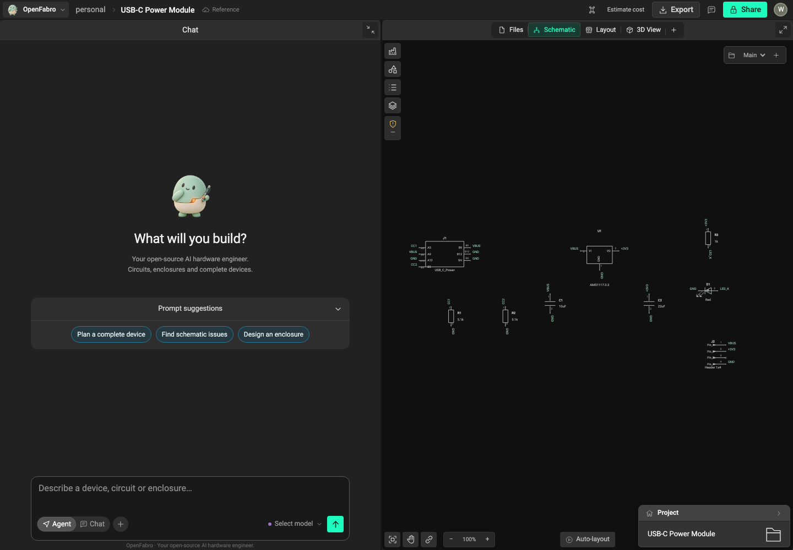
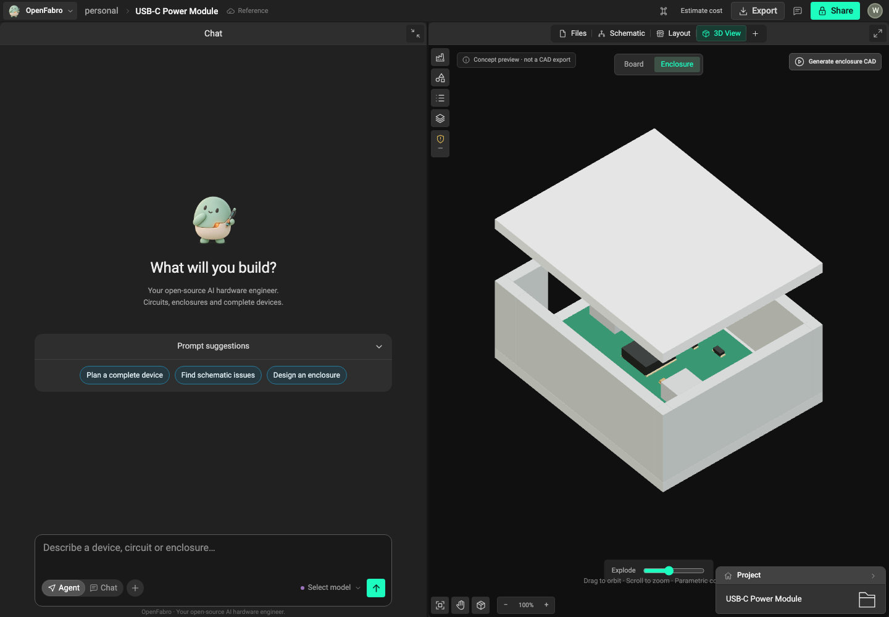

<p align="center">
  
</p>

<h1 align="center">OpenFabro</h1>

<p align="center"><strong>The open-source AI hardware engineer.</strong></p>
<p align="center">Circuits. Enclosures. Complete devices.</p>

<p align="center">
  <a href="https://github.com/AllenPeng0209/OpenFabro/actions/workflows/ci.yml"></a>
  <a href="LICENSE"></a>
  <a href="pyproject.toml"></a>
  
</p>

<p align="center">
  <a href="#quick-start">Quick Start</a> ·
  <a href="docs/index.md">Documentation</a> ·
  <a href="CONTRIBUTING.md">Contributing</a> ·
  <a href="https://github.com/AllenPeng0209/OpenFabro/issues">Issues</a>
</p>

OpenFabro brings AI-assisted electronics, mechanical design, and manufacturing preparation into
one local workspace. Start with a product requirement, develop an editable circuit and enclosure,
run engineering checks, and assemble the files a supplier needs to review your design.

The goal is straightforward: **make the entire device part of the design process.** Board geometry,
mounting points, connector access, component clearances, firmware pin assignments, and production
files belong in the same engineering conversation.



*A local engineering workspace with AI assistance, native KiCad geometry, and editable project files.
The illustrated USB-C project is a reference design.*

## Why OpenFabro

- **Design across disciplines.** Work on circuits, PCB layout, mechanical parts, enclosures, and
  assembly context without losing sight of the complete device.
- **Keep the engineering inspectable.** Review native files, simulation results, check reports,
  design revisions, and the evidence behind a proposed change.
- **Choose your AI provider.** Use a locally signed-in Codex CLI, Claude, or an OpenAI-compatible
  provider, including a local model server.
- **Own your workspace.** Run the application on your computer and keep project files on your
  filesystem. AI requests go to the provider you configure.
- **Prepare a concrete handoff.** Export editable design files and freeze manufacturing packages
  with checksums, design snapshots, and supporting engineering findings.

## What you can do

| Area | Capabilities |
| --- | --- |
| **Electronics** | Native KiCad schematic and PCB generation; component and net editing; reusable circuit blocks; hierarchical sheets and parametric symbol layouts. |
| **PCB layout** | Interactive traces and vias, differential routing, length tuning, copper editing, physical stackups, layer controls, and individual pad geometry. |
| **Mechanical design** | Parametric parts and constrained sketches, linked assemblies, native CAD and mesh imports, drawing profiles, materials, and geometry inspection. |
| **Engineering checks** | KiCad ERC/DRC, ngspice simulation, power budgets, trace heating, voltage drop, impedance, and enclosure thermal estimates, with the relevant tools installed. |
| **AI assistance** | Separate Chat and Agent modes; reviewed design and document proposals; engineering tools; project context; version guards for concurrent edits. |
| **Project workflow** | Local files and Markdown documents, revision history, undo/redo, draft recovery, BOM export, and scoped sharing roles. |
| **Manufacturing preparation** | Gerbers, drills, BOM and placement files; enclosure exports; starter firmware; immutable production ZIPs; supplier RFQs, quotation records, and progress tracking. |



*An enclosure concept preview. Native CAD generation and exported geometry are separate steps.*

## Quick start

**Requirements:** Git and Python 3.10 or newer. OpenFabro runs as a Python server with a browser
interface. Native engineering tools are installed separately; Node.js is needed only for frontend
development and browser tests.

### macOS and Linux

```sh
git clone https://github.com/AllenPeng0209/OpenFabro.git
cd OpenFabro
python3 -m venv .venv
source .venv/bin/activate
python -m pip install --upgrade pip
python -m pip install -e .
python -m openfabro
```

### Windows PowerShell

```powershell
git clone https://github.com/AllenPeng0209/OpenFabro.git
cd OpenFabro
py -m venv .venv
.\.venv\Scripts\python.exe -m pip install --upgrade pip
.\.venv\Scripts\python.exe -m pip install -e .
.\.venv\Scripts\python.exe -m openfabro
```

Open **[http://127.0.0.1:8770](http://127.0.0.1:8770)** if the browser does not open automatically.
The default command listens on localhost. Use `--port 8780` to select another port or
`--no-browser` to suppress the browser launch.

For a checkout-local workspace on macOS or Linux, use `./run-workbench.sh`. It stores settings and
projects under the ignored `.local/` directory. The [installation guide](docs/how-to/install.md)
also covers the platform installers and native tool setup.

### Connect your engineering tools

```sh
python -m openfabro.doctor
```

The diagnostic command reports detected tools and missing dependencies. Configure paths in
**Settings** when an application is installed outside the usual locations.

| Tool | Purpose |
| --- | --- |
| **KiCad and its libraries** | Native schematic and PCB files, geometry, electrical and layout checks, and fabrication exports. |
| **TraceMaker** | Automated component placement and PCB routing. |
| **ngspice** | Circuit simulation and interactive simulation analysis. |
| **FreeCAD** | Enclosure generation and supported native CAD operations. |
| **PlatformIO** | Optional compilation and flashing of generated starter firmware. |

### Start your first project

1. Create a project or open the bundled reference design.
2. Choose an AI provider in **Settings** when you want AI assistance. Opening the workspace and
   editing a project do not require an AI request.
3. Describe the requirements, inspect proposed changes, and refine the schematic, layout, and
   mechanical design.
4. Run the relevant checks, inspect their reports, and prepare a production package for review.

For example:

> Design a compact USB-C-powered environmental sensor. Plan the power budget, sensor connections,
> board dimensions, enclosure openings, and firmware pin map. Identify the engineering checks
> required before fabrication.

Follow [Your first board](docs/tutorials/first-board.md) for the engineering pipeline, or read the
[workbench guide](docs/workbench.md) for the interactive editor.

## Project status

OpenFabro is an active **developer preview**. Interfaces and file formats may change, and feature
coverage varies across design workflows. The [implementation status](docs/FLUX_PARITY.md) and
[roadmap](ROADMAP.md) document remaining work.

Engineering checks report the evidence available from the tools that actually ran. Generated
designs, simulations, and manufacturing packages require engineering review and physical
validation before fabrication or deployment.

Supplier workflows currently use exported packages and manual handoff. Direct JLCPCB and PCBWay
factory API integrations are **not enabled**. Creating an RFQ, recording a quote, or accepting an
offer does not place or pay for a factory order. See the [production workflow](docs/production-mvp.md).

## Documentation

| Resource | Start here for |
| --- | --- |
| [Documentation overview](docs/index.md) | Tutorials, how-to guides, references, and engineering explanations. |
| [Workbench guide](docs/workbench.md) | Editing, files, AI assistance, mechanical workflows, and current boundaries. |
| [Installation](docs/how-to/install.md) | Platform setup, native dependencies, and diagnostics. |
| [Production handoff](docs/production-mvp.md) | Estimates, frozen packages, supplier inquiries, and quotation tracking. |
| [MCP integration](docs/how-to/mcp.md) | Using the engineering tools from another agent. |
| [Development](docs/development.md) | Environment setup, test commands, documentation builds, and architecture. |
| [Changelog](CHANGELOG.md) | Notable changes and engineering history. |

## Development and contributing

Contributions are welcome across electrical engineering, mechanical CAD, simulation, frontend
development, testing, and documentation. Start with [CONTRIBUTING.md](CONTRIBUTING.md), then open
an issue or a focused pull request with enough evidence to review the change.

```sh
python -m pip install -e ".[dev,docs]"
npm ci
python -m pytest tests -q
npm test
python -m mkdocs build --strict
```

See [SECURITY.md](SECURITY.md) for vulnerability reporting and [THIRD_PARTY_NOTICES.md](THIRD_PARTY_NOTICES.md)
for upstream and bundled dependency attribution.

## License and acknowledgments

OpenFabro is free software licensed under the **GNU General Public License, version 3 or later**.
See [LICENSE](LICENSE).

OpenFabro builds on [WholeBoard](https://github.com/DingoOz/WholeBoard), whose engineering foundation
and Git history are retained. It also depends on the work of the KiCad, TraceMaker, ngspice,
FreeCAD, Open CASCADE, and wider open-source communities. Bundled third-party assets retain
their respective license notices.

The public package and command are `openfabro`. The `wholeboard` implementation namespace,
legacy commands, and existing settings remain supported for compatibility.
