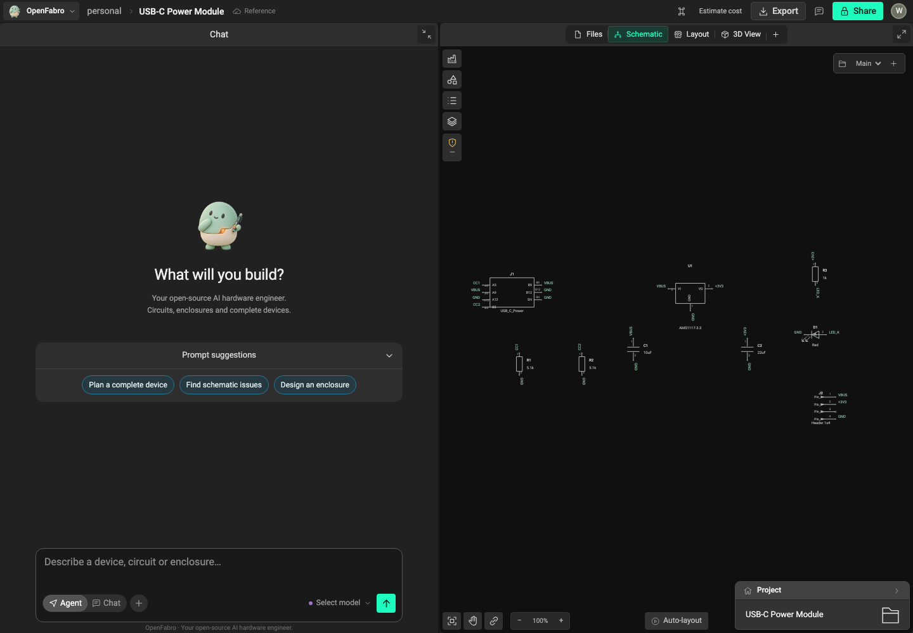

# OpenFabro

**The open-source AI hardware engineer.**

**Circuits. Enclosures. Complete devices.**

{ width="180" }

Describe the hardware product you want to build. OpenFabro brings requirements, electronics,
enclosure and mechanical fit, starter firmware, validation and manufacturing preparation into
one local workspace. PCB dimensions, mounting holes, connector openings, component clearances
and thermal assumptions are part of one product design.

The current implementation focuses on PCB-based devices and parametric, 3D-printable enclosures.
It uses real JLCPCB parts, **KiCad**, **TraceMaker**, **ngspice** and **FreeCAD**. Each step produces
editable outputs and evidence to inspect; see the [current limits](reference/limits.md).

| Product area | Current workflow |
|---|---|
| Circuits | Requirements, parts, schematics, PCB layout, electrical checks and fabrication files |
| Enclosures and mechanical fit | Parametric enclosure CAD, board mounting, connector openings, clearances and assembly previews |
| Complete devices | Shared requirements, thermal and power assumptions, starter firmware, bring-up guidance and manufacturing estimates |

See the [hardware workbench](workbench.md) and [brand and mascot](brand.md).

!!! warning "Under construction"
    OpenFabro is in active development. Expect rough edges, breaking changes and boards that need a human check
    before you order them.

-   :material-school: **[Tutorials](tutorials/index.md)**

    Build your first board from a sentence, then a mains-powered one.

-   :material-tools: **[How-to guides](how-to/index.md)**

    Install, import a KiCad project, make a panel, order, flash, use the checks from other agents.

-   :material-book-open-variant: **[Reference](reference/index.md)**

    The design spec, building blocks, interface profiles, mains figures, checks, settings and the Python API.

-   :material-lightbulb-on: **[Explanation](explanation/index.md)**

    How a build works, how rules reach the router, the heat models and the two AI models.

## What it uses

| Tool | What for |
|---|---|
| [KiCad](https://www.kicad.org/) 9 or 10 | Libraries, schematic and board files, ERC, DRC, zone fill, renders, fab outputs |
| [TraceMaker](https://github.com/DingoOz/TraceMaker) | Placement and routing |
| [ngspice](https://ngspice.sourceforge.io/) | Circuit simulation |
| [FreeCAD](https://www.freecad.org/) 1.0+ | Enclosures |
| [KiKit](https://github.com/yaqwsx/KiKit) (optional) | Panels |
| [PlatformIO](https://platformio.org/) (optional) | Compiling the starter firmware |
| An AI | Claude, OpenAI, Grok, or a local model through any OpenAI-compatible server |

Also: [Standards and sources](standards.md) lists every engineering figure OpenFabro relies on, and
[Decisions](decisions/index.md) records why things are the way they are.
